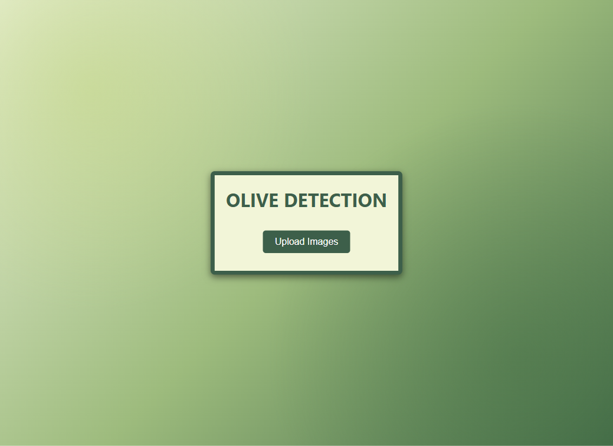

# Olive Ripeness Detection

[](https://github.com/BartoloMorgigno11/Olive-detection-using-CNN-models-based-on-fine-tuned-YOLOv8/actions/workflows/ci.yml)

A full-stack prototype for analysing olive images with a fine-tuned YOLOv8 detector. The application detects olives, reports an image-space ellipse-area proxy, and classifies ripeness from image colour features. A React interface submits images to a Flask API and presents the generated report.

> This is a portfolio prototype, not a calibrated agricultural measurement system. The area proxy is measured in px², not grams; it changes with camera distance and image scale. Ripeness labels are image-colour heuristics and are sensitive to illumination.

**Project authorship:** Individual project by Bartolo Morgigno.

## Architecture

- `frontend/` — React interface for image upload, progress tracking, and reports.
- `backend/` — Flask API plus the YOLOv8 inference and analysis pipeline.
- `neural_network/` — notebooks documenting data preparation, training, and experimentation.
- `test/` — place non-restricted demo images here for local validation.

## Demo

**Upload flow**



**Analysis report**

No current analysis-result screenshot is included: the historical image (`docs/images/analysis-results.png`) in the repository predates the area-proxy correction and must not be read as evidence for this version. Generate a fresh report locally with a permitted image and local weights before adding a new screenshot.

## Requirements

- Python 3.10–3.12
- Node.js 18+
- [uv](https://docs.astral.sh/uv/) (recommended for the CUDA installation commands below)
- A local YOLOv8 `.pt` weights file. The training data and weights are not distributed with this repository.

## Run locally

### Backend

```powershell
uv venv .venv --python 3.12
uv pip install --python .\.venv\Scripts\python.exe --torch-backend=cu124 -r backend/requirements.txt
$env:OLIVE_MODEL_PATH = 'C:\path\to\olive-yolov8n-v2.pt'
.\.venv\Scripts\python.exe backend/server.py
```

The command installs a CUDA build of PyTorch (`cu124`) for compatible NVIDIA GPUs. For CPU-only execution, use `pip install -r backend/requirements.txt` instead. The API starts on `http://localhost:3001`. Alternatively, place the weights at `backend/yolov8/olive-yolov8n-v2.pt`; this directory is intentionally ignored by Git.

### Frontend

```powershell
cd frontend
npm install
npm start
```

The frontend opens on `http://localhost:3000`.

## Train a local detector from scratch

The repository excludes the dataset and fine-tuned weights, but the following steps reproduce a local model.

1. On [Roboflow Universe, open Olive Fruit Detection v1](https://universe.roboflow.com/aliasghar/olive-fruit-detection/dataset/1), choose **Download dataset**, select **YOLOv8**, and extract the ZIP so the following folders exist:

   ```text
   neural_network/data/olive-fruit-detection/train/images
   neural_network/data/olive-fruit-detection/valid/images
   neural_network/data/olive-fruit-detection/test/images
   ```

2. Download the public YOLOv8n base checkpoint:

   ```powershell
   New-Item -ItemType Directory -Force .\neural_network\models
   Invoke-WebRequest -Uri 'https://github.com/ultralytics/assets/releases/download/v8.2.0/yolov8n.pt' -OutFile '.\neural_network\models\yolov8n.pt'
   ```

3. Train the detector (the script selects CUDA automatically when the installed PyTorch build can see an NVIDIA GPU):

   ```powershell
   .\.venv\Scripts\python.exe .\neural_network\train_v2.py
   ```

4. Configure the newly produced model for the backend:

   ```powershell
   New-Item -ItemType Directory -Force .\backend\yolov8
   Copy-Item .\neural_network\runs\olive-v2\weights\best.pt .\backend\yolov8\olive-yolov8n-v2.pt
   ```

The dataset source is licensed under CC BY 4.0. The dataset, checkpoints, fine-tuned weights, and training outputs remain ignored by Git; do not commit or redistribute them without respecting their respective licences.

## Limitations

- The ellipse-area proxy is not a physical scale measurement and must not be interpreted as grams without calibration.
- Ripeness is a colour-based heuristic (gray-intensity thresholds at 140 and 180) and is not agronomically validated.
- This repository does not claim production or agronomic validation.
- The upload lock is process-local. Run one Flask worker only; multi-process or multi-instance deployment needs shared job storage and locking, which are outside this prototype.
- See [experimental evidence and limits](docs/EXPERIMENTAL_EVIDENCE.md) before interpreting historic notebook outputs as model metrics.

## License

The repository includes an MIT license notice for its own source code. Ultralytics YOLO is a third-party dependency distributed under [AGPL-3.0 or an Enterprise license](https://www.ultralytics.com/license). The MIT notice does not override applicable third-party obligations or establish compliance for an integrated application. Licensing compatibility must be assessed before further redistribution or deployment. No Enterprise license is claimed. Dataset archives and trained weights are not distributed with this repository.
