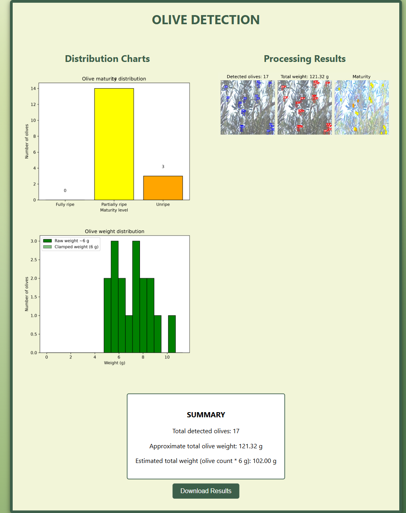

# Olive Ripeness Detection

A full-stack prototype for analysing olive images with a fine-tuned YOLOv8 detector. The application detects olives, estimates a pixel-based weight proxy, and classifies ripeness from image colour features. A React interface submits images to a Flask API and presents the generated report.

> This is a portfolio prototype, not a calibrated agricultural measurement system. Weight and ripeness estimates depend on camera distance, illumination, and the supplied model weights.

## Architecture

- `frontend/` — React interface for image upload, progress tracking, and reports.
- `backend/` — Flask API plus the YOLOv8 inference and analysis pipeline.
- `neural_network/` — notebooks documenting data preparation, training, and experimentation.
- `test/` — place non-restricted demo images here for local validation.

## Demo

**Upload flow**


**Analysis report**



The analysis screenshot uses an example image from the [Olive Fruit Detection dataset on Roboflow Universe](https://universe.roboflow.com/aliasghar/olive-fruit-detection/dataset/1), licensed under CC BY 4.0. The reported detections and estimates were generated locally with the fine-tuned model described in this repository.

## Requirements

- Python 3.10–3.12
- Node.js 18+
- A local YOLOv8 `.pt` weights file. The training data and weights are not distributed with this repository.

## Run locally

### Backend

```powershell
uv venv .venv --python 3.12
uv pip install --python .\.venv\Scripts\python.exe --torch-backend=cu124 -r backend/requirements.txt
$env:OLIVE_MODEL_PATH = 'C:\path\to\olive-yolov8n-v2.pt'
.\.venv\Scripts\python.exe backend/server.py
```

The command installs a CUDA build of PyTorch (`cu124`) for compatible NVIDIA GPUs. For CPU-only execution, use `pip install -r backend/requirements.txt` instead. The API starts on `http://localhost:3001`. Alternatively, place the weights at `backend/yolov8/olive-yolov8n-v2.pt`; this directory is intentionally ignored by Git.

### Frontend

```powershell
cd frontend
npm install
npm start
```

The frontend opens on `http://localhost:3000`.

## Data and model availability

The original image dataset and trained weights are excluded because their redistribution status must be verified. The application gives a clear error when weights are not configured rather than silently failing. To make a public demo, add images you own or are licensed to share and distribute the model separately through a release asset or documented download.

## Limitations

- Weight is an image-space approximation, not a physical scale measurement.
- Ripeness is a colour-based heuristic and is sensitive to lighting.
- This repository does not claim production or agronomic validation.

## License

The source code is available under the MIT License. Third-party data, trained weights, and their licences are not included.
